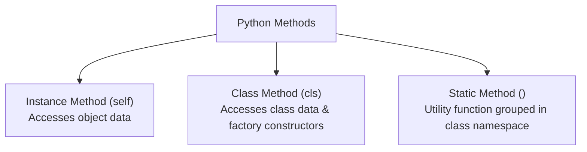
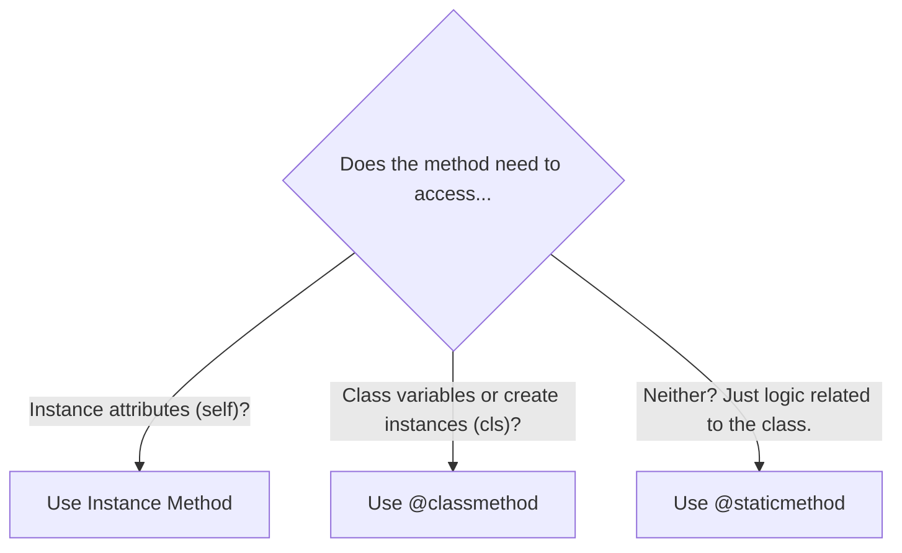

<div align="center">
  <h1> 30 Days Of Python: Day 21 - Python Class Methods</h1>
  <a class="header-badge" target="_blank" href="https://www.linkedin.com/in/asabeneh/">
  
  </a>
  <a class="header-badge" target="_blank" href="https://twitter.com/Asabeneh">
  
  </a>

<sub>Author:
<a href="https://www.linkedin.com/in/asabeneh/" target="_blank">Asabeneh Yetayeh</a><br>
<small>Second Edition: July, 2021</small>
</sub>

</div>

[<< Previous: Python Class Properties](./05_python_class_properties.md) | [Day 21 Overview](./21_classes_and_objects.md) | [Next: Python Magic Methods >>](./07_python_magic_methods.md)

---

- [📘 Day 21 - Python Class Methods](#-day-21---python-class-methods)
  - [The Three Types of Methods in Python](#the-three-types-of-methods-in-python)
  - [1. Instance Methods](#1-instance-methods)
  - [2. Class Methods (`@classmethod`)](#2-class-methods-classmethod)
    - [Class Methods as Alternative Constructors (Factory Methods)](#class-methods-as-alternative-constructors-factory-methods)
  - [3. Static Methods (`@staticmethod`)](#3-static-methods-staticmethod)
  - [Comparison Table: Instance vs Class vs Static Methods](#comparison-table-instance-vs-class-vs-static-methods)
  - [Choosing the Right Method Type](#choosing-the-right-method-type)
  - [Exercises](#exercises)

---

# 📘 Day 21 - Python Class Methods

## The Three Types of Methods in Python

In Python classes, methods fall into three distinct categories based on what data they have access to:

1. **Instance Methods**: Bound to the instance; access and modify object state (`self`).
2. **Class Methods**: Bound to the class; access and modify class state (`cls`).
3. **Static Methods**: Bound neither to instance nor class; independent helper functions housed inside a class namespace.



---

## 1. Instance Methods

An instance method is the default and most common method type in Python. It accepts `self` as its first parameter to access and mutate instance attributes.

```py
class Employee:
    def __init__(self, name, salary):
        self.name = name
        self.salary = salary

    def give_raise(self, percentage):
        self.salary += self.salary * (percentage / 100)
        return self.salary

emp = Employee("Alice", 50000)
print(emp.give_raise(10))  # 55000.0
```

---

## 2. Class Methods (`@classmethod`)

A **class method** takes the class itself as its first argument (conventionally named `cls`) instead of an instance. It is decorated with `@classmethod`.

Class methods can access and modify class-level state that applies to all instances:

```py
class Book:
    total_books_created = 0  # Class variable

    def __init__(self, title):
        self.title = title
        Book.total_books_created += 1

    @classmethod
    def get_inventory_count(cls):
        return f"Total books currently registered: {cls.total_books_created}"

b1 = Book("1984")
b2 = Book("Brave New World")

# Called on the class itself:
print(Book.get_inventory_count())  # Total books currently registered: 2
```

### Class Methods as Alternative Constructors (Factory Methods)

The most popular real-world use case for `@classmethod` is creating **factory methods** that instantiate objects from different data formats (e.g., strings, JSON, timestamps):

```py
from datetime import date

class Person:
    def __init__(self, name, age):
        self.name = name
        self.age = age

    @classmethod
    def from_birth_year(cls, name, birth_year):
        """Alternative constructor calculating age from birth year"""
        current_year = date.today().year
        calculated_age = current_year - birth_year
        return cls(name, calculated_age)

    @classmethod
    def from_string(cls, person_str):
        """Alternative constructor parsing a formatted string like 'Alice, 30'"""
        name, age = person_str.split(",")
        return cls(name.strip(), int(age.strip()))

# Standard initialization
p1 = Person("Alice", 28)

# Alternative constructor 1: from birth year
p2 = Person.from_birth_year("Bob", 1995)

# Alternative constructor 2: from comma-separated string
p3 = Person.from_string("Charlie, 40")

print(p1.name, p1.age)  # Alice 28
print(p2.name, p2.age)  # Bob (CurrentYear - 1995)
print(p3.name, p3.age)  # Charlie 40
```

---

## 3. Static Methods (`@staticmethod`)

A **static method** is decorated with `@staticmethod`. It does **not** accept `self` or `cls`. It behaves like a plain, normal function, but lives within the class namespace because it is logically related to the class concept.

```py
class DateUtility:
    @staticmethod
    def is_leap_year(year):
        """Checks if a given year is a leap year"""
        return (year % 4 == 0 and year % 100 != 0) or (year % 400 == 0)

    @staticmethod
    def format_date(day, month, year):
        return f"{year:04d}-{month:02d}-{day:02d}"

print(DateUtility.is_leap_year(2024))         # True
print(DateUtility.is_leap_year(2023))         # False
print(DateUtility.format_date(5, 7, 2025))    # 2025-07-05
```

---

## Comparison Table: Instance vs Class vs Static Methods

| Aspect | Instance Method | Class Method (`@classmethod`) | Static Method (`@staticmethod`) |
| :--- | :--- | :--- | :--- |
| **First Argument** | `self` (the instance) | `cls` (the class) | None (regular arguments only) |
| **Decorator** | None | `@classmethod` | `@staticmethod` |
| **Access to Instance State?** | Yes (`self.attr`) | No | No |
| **Access to Class State?** | Yes (via `self.__class__`) | Yes (`cls.attr`) | No (unless hardcoding class name) |
| **Can Modify Object?** | Yes | No | No |
| **Can Modify Class?** | Yes | Yes | No |
| **Primary Use Cases** | Standard object behavior | Factory constructors, class-wide state | Helper/utility methods |

---

## Choosing the Right Method Type



---

## Exercises

1. Create a `User` class with an instance method `get_info()`.
2. Add a `@classmethod` called `from_dict(data_dict)` that instantiates a `User` from a dictionary like `{"name": "John", "email": "john@email.com"}`.
3. Add a `@staticmethod` called `is_valid_email(email)` that checks if the string contains both `"@"` and `"."`.

---

[<< Previous: Python Class Properties](./05_python_class_properties.md) | [Day 21 Overview](./21_classes_and_objects.md) | [Next: Python Magic Methods >>](./07_python_magic_methods.md)
