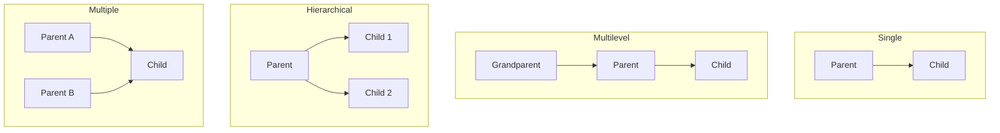

<div align="center">
  <h1> 30 Days Of Python: Day 21 - Python Inheritance</h1>
  <a class="header-badge" target="_blank" href="https://www.linkedin.com/in/asabeneh/">
  
  </a>
  <a class="header-badge" target="_blank" href="https://twitter.com/Asabeneh">
  
  </a>

<sub>Author:
<a href="https://www.linkedin.com/in/asabeneh/" target="_blank">Asabeneh Yetayeh</a><br>
<small>Second Edition: July, 2021</small>
</sub>

</div>

[<< Previous: Python Magic Methods](./07_python_magic_methods.md) | [Day 21 Overview](./21_classes_and_objects.md) | [Next: Python Polymorphism >>](./09_python_polymorphism.md)

---

- [📘 Day 21 - Python Inheritance](#-day-21---python-inheritance)
  - [What is Inheritance?](#what-is-inheritance)
  - [Basic Inheritance Syntax](#basic-inheritance-syntax)
  - [The `super()` Built-in Function](#the-super-built-in-function)
  - [Method Overriding](#method-overriding)
  - [Types of Inheritance in Python](#types-of-inheritance-in-python)
    - [1. Single Inheritance](#1-single-inheritance)
    - [2. Multilevel Inheritance](#2-multilevel-inheritance)
    - [3. Hierarchical Inheritance](#3-hierarchical-inheritance)
    - [4. Multiple Inheritance](#4-multiple-inheritance)
  - [Method Resolution Order (MRO) and the Diamond Problem](#method-resolution-order-mro-and-the-diamond-problem)
  - [Type Checking: `isinstance()` and `issubclass()`](#type-checking-isinstance-and-issubclass)
  - [Exercises](#exercises)

---

# 📘 Day 21 - Python Inheritance

## What is Inheritance?

**Inheritance** is an essential mechanism in object-oriented programming that allows a class (called a **child class**, **subclass**, or **derived class**) to inherit properties and methods from another class (called a **parent class**, **superclass**, or **base class**).

Benefits of inheritance:
- **Code Reusability**: Write logic in the parent class once; reuse it across all derived classes.
- **Extensibility**: Add or alter capabilities without modifying the original parent class.
- **Hierarchical Modeling**: Model real-world is-a relationships naturally (e.g., a `Student` is a `Person`).

---

## Basic Inheritance Syntax

To inherit from a parent class, pass the parent class name inside parentheses after the child class name:

```py
# Parent Class (Superclass)
class Person:
    def __init__(self, firstname, lastname):
        self.firstname = firstname
        self.lastname = lastname

    def get_full_name(self):
        return f"{self.firstname} {self.lastname}"

# Child Class (Subclass) inheriting from Person
class Student(Person):
    pass

student = Student("John", "Doe")
print(student.get_full_name())  # John Doe (inherited directly from Person)
```

---

## The `super()` Built-in Function

When a child class defines its own `__init__()` method, it overrides the parent's `__init__()`. To keep and initialize the parent's attributes, call `super().__init__(...)`:

```py
class Person:
    def __init__(self, firstname, lastname, age):
        self.firstname = firstname
        self.lastname = lastname
        self.age = age

    def introduce(self):
        return f"Hi, I am {self.firstname} {self.lastname}, age {self.age}."

class Student(Person):
    def __init__(self, firstname, lastname, age, student_id, major):
        # Call the parent class constructor
        super().__init__(firstname, lastname, age)
        # Initialize child-specific attributes
        self.student_id = student_id
        self.major = major

s = Student("Alice", "Smith", 21, "ST-1044", "Computer Science")
print(s.introduce())   # Hi, I am Alice Smith, age 21.
print(s.student_id)    # ST-1044
print(s.major)         # Computer Science
```

---

## Method Overriding

**Method overriding** occurs when a child class provides a specialized implementation of a method that is already defined in its parent class:

```py
class Employee:
    def __init__(self, name, base_salary):
        self.name = name
        self.base_salary = base_salary

    def calculate_pay(self):
        return self.base_salary

class Manager(Employee):
    def __init__(self, name, base_salary, bonus):
        super().__init__(name, base_salary)
        self.bonus = bonus

    # Overriding the parent's calculate_pay method
    def calculate_pay(self):
        # Extend parent logic with child bonus
        return super().calculate_pay() + self.bonus

emp = Employee("Bob", 4000)
mgr = Manager("Carol", 6000, 1500)

print(f"{emp.name} Pay: ${emp.calculate_pay()}")  # Bob Pay: $4000
print(f"{mgr.name} Pay: ${mgr.calculate_pay()}")  # Carol Pay: $7500
```

---

## Types of Inheritance in Python



### 1. Single Inheritance
A child class inherits from a single parent class.

### 2. Multilevel Inheritance
A child class inherits from a parent, which in turn inherits from another class (Grandparent -> Parent -> Child).

```py
class LivingBeing:
    def breathe(self):
        return "Breathing air..."

class Animal(LivingBeing):
    def move(self):
        return "Moving..."

class Dog(Animal):
    def bark(self):
        return "Woof!"

dog = Dog()
print(dog.breathe())  # From LivingBeing
print(dog.move())     # From Animal
print(dog.bark())     # From Dog
```

### 3. Hierarchical Inheritance
Multiple child classes inherit from the same single parent class.

```py
class Vehicle:
    def start_engine(self):
        return "Engine started"

class Car(Vehicle):
    pass

class Motorcycle(Vehicle):
    pass
```

### 4. Multiple Inheritance
A class can inherit from more than one parent class simultaneously:

```py
class Flyer:
    def fly(self):
        return "Flying high in the sky!"

class Swimmer:
    def swim(self):
        return "Swimming in the water!"

class Duck(Flyer, Swimmer):
    pass

mallard = Duck()
print(mallard.fly())   # Flying high in the sky!
print(mallard.swim())  # Swimming in the water!
```

---

## Method Resolution Order (MRO) and the Diamond Problem

When a class inherits from multiple parents that share a common ancestor, ambiguity can arise (the **Diamond Problem**). Python resolves this cleanly using the **C3 Linearization Algorithm** to determine the **Method Resolution Order (MRO)**:

```py
class A:
    def identify(self):
        return "Class A"

class B(A):
    def identify(self):
        return "Class B"

class C(A):
    def identify(self):
        return "Class C"

class D(B, C):
    pass

d = D()
print(d.identify())  # Class B (B comes before C in declaration order)

# Inspecting the resolution order:
print(D.mro())
# [<class '__main__.D'>, <class '__main__.B'>, <class '__main__.C'>, <class '__main__.A'>, <class 'object'>]
```

---

## Type Checking: `isinstance()` and `issubclass()`

```py
print(isinstance(d, D))         # True
print(isinstance(d, B))         # True
print(isinstance(d, A))         # True
print(isinstance(d, object))    # True (all classes inherit from object)

print(issubclass(D, B))         # True
print(issubclass(B, A))         # True
print(issubclass(A, D))         # False
```

---

## Exercises

1. Create a base class `Shape` with a method `area()` that raises `NotImplementedError`.
2. Create derived classes `Rectangle(Shape)` and `Circle(Shape)` that implement `area()`.
3. Create a class hierarchy: `Device -> Phone -> SmartPhone`, adding specialized attributes at each level.
4. Experiment with multiple inheritance using `Logger` and `Repository` mixin classes.

---

[<< Previous: Python Magic Methods](./07_python_magic_methods.md) | [Day 21 Overview](./21_classes_and_objects.md) | [Next: Python Polymorphism >>](./09_python_polymorphism.md)
